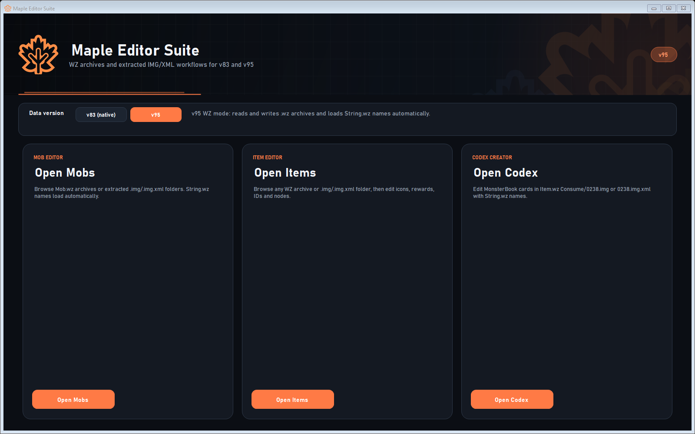
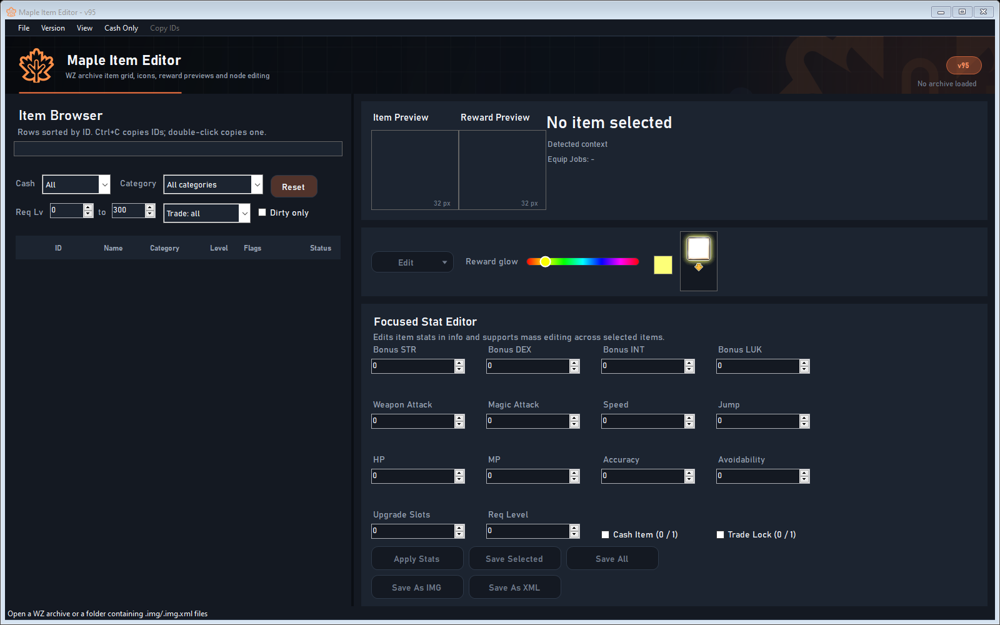
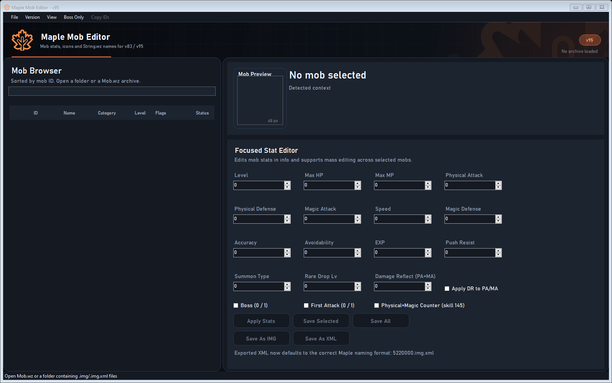
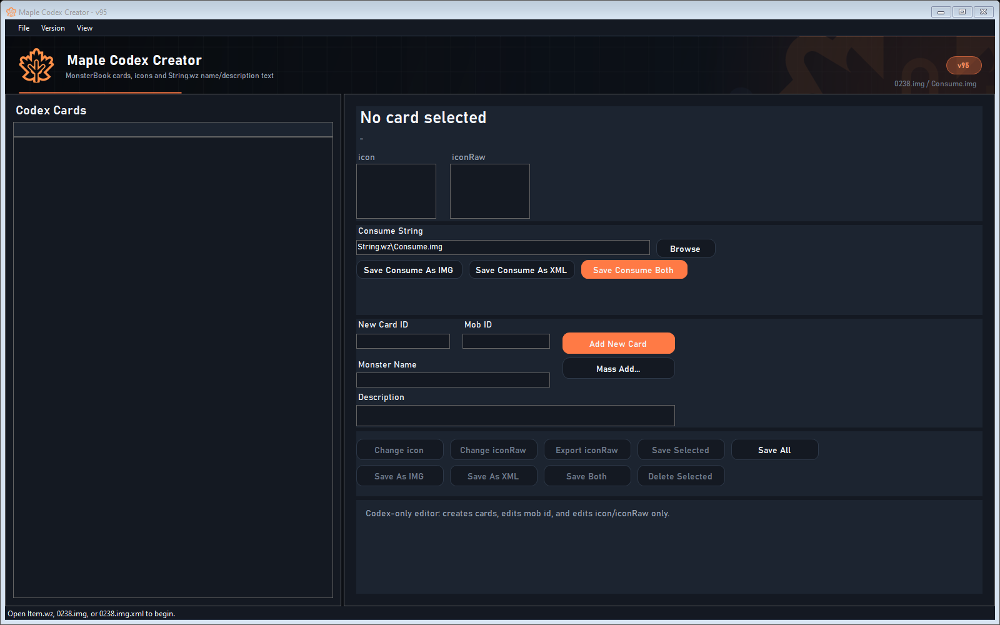

<p align="center">
  
</p>

<h1 align="center">Maple Editor Suite</h1>

<p align="center">
  A modern, local-first WZ / IMG / XML editor suite for MapleStory v83 and v95.
</p>

<p align="center">
  
  
  
  
</p>

---

## Overview

Maple Editor Suite bundles three focused editors behind one launcher:

| Editor | Purpose |
| --- | --- |
| **Item Editor** | Browse and edit equipment and item nodes, icons, reward frames, stats, IDs, inventory slots and arbitrary info nodes. |
| **Mob Editor** | Browse and edit mob stats, flags, previews and String.wz names. |
| **Codex Creator** | Create and edit MonsterBook cards in `Item.wz/Consume/0238.img` and `String.wz/Consume.img`. |

It works with both of MapleStory's common data layouts:

- **v95 WZ archives** — `Item.wz`, `Character.wz`, `Mob.wz`, `String.wz`, and other `.wz` files.
- **v83 native data** — extracted `Data` folders containing `.img` and `.img.xml` files.

Both workflows are usable from the same build. The data-version selector changes the intended workflow, default folders and guidance; the parsers auto-detect the actual format.

> [!WARNING]
> Close MapleStory, the server, or any tool holding a WZ file before saving. Windows cannot replace a file that another process has open. The Item Editor detects this and lists the locking processes before repacking.

---

## Screenshots

<p align="center">
  
</p>

<table>
  <tr>
    <td width="50%"><br><sub><b>Item Editor</b> — filters, previews, reward glow and stat editing</sub></td>
    <td width="50%"><br><sub><b>Mob Editor</b> — mob stats, flags and mass editing</sub></td>
  </tr>
  <tr>
    <td colspan="2"><br><sub><b>Codex Creator</b> — MonsterBook cards, icons and String.wz text</sub></td>
  </tr>
</table>

---

## Feature Breakdown

### Item Editor

<details open>
<summary><b>Loading and browsing</b></summary>

- Open any WZ archive (`Item.wz`, `Character.wz`, `Pet.wz`, `TamingMob.wz`, and others) with a folder/category picker.
- Open extracted `.img` and `.img.xml` folders.
- Detects binary WZ IV variants automatically (`GMS`, `EMS`, `BMS`).
- Expands grouped item images into individual item nodes, including:
  - `Item.wz` → `Cash`, `Consume`, `Etc`, `Install`, `Pet`, `Special`
  - `Character.wz` → `Accessory`, `Cap`, `Cape`, `Coat`, `Face`, `Glove`, `Hair`, `Longcoat`, `Pants`, `PetEquip`, `Ring`, `Shield`, `Shoes`, `TamingMob`, `Weapon`, and root images
- Loads sibling `String.wz` automatically for names across equipment, consumables, etc., cash, install and pet categories.
- Numeric item-ID sorting, full-text search, and filters for:
  - Cash / non-cash
  - Category
  - Required-level range
  - Trade-locked / tradeable
  - Dirty-only changes
- Multi-select with selection preservation during filtering and refreshes.
- Double-click any row to copy that single item ID.
- `Ctrl+C` copies all selected item IDs.
- Selectable item detail text (name, context, equip jobs, path).

</details>

<details open>
<summary><b>Editing</b></summary>

- Focused stat editor with mass-apply support:
  - `incSTR`, `incDEX`, `incINT`, `incLUK`
  - `incPAD`, `incMAD`
  - `incSpeed`, `incJump`
  - `incMHP`, `incMMP`
  - `incACC`, `incEVA`
  - `tuc`, `reqLevel`
  - `cash`, `tradeBlock`
- Edit dropdown actions:
  - Change ID
  - Change Job (`reqJob`)
  - Change `iSlot`
  - Change `vSlot`
  - Change name
  - Copy item ID
  - Edit info nodes
  - Duplicate item
  - New item
- Generic info-node editor for adding, editing, renaming and deleting:
  - `Int`, `Short`, `Long`, `String`, `Vector`
  - Canvas, sub-property and UOL nodes are shown read-only for safety
- ID changer supports both image-per-item entries and grouped item nodes, with duplicate checks.
- Changing an ID moves the matching `String.wz` entry and rewrites linked item IDs, `source` paths, UOLs, `_inlink` and `_outlink` values.
- Create blank items or duplicate existing items with a new ID, including grouped `Item.wz` entries; new items copy matching `String.wz` text and rewrite references to the new ID.
- Reads linked canvases through `_inlink` / `_outlink`, and removes links when replacing an icon with a concrete image.
- Localized String.wz lookup for the selected item category and ID.

</details>

<details open>
<summary><b>Icons and reward frames</b></summary>

- Change `icon` and `iconRaw` from PNG files.
- Export `icon` and `iconRaw` as PNG for one or many selected items.
- Add, change or delete `iconReward` frames.
- Built-in reward-frame template with:
  - A protected white item area
  - Colored glow and arrow
  - Full-spectrum hue slider
  - Centered `iconRaw` compositing
  - Automatic canvas origin handling
- Batch add `iconReward` for every selected item through the splash/progress UI.
- Each batch item is generated from its own `iconRaw`/`icon` and validated against its own item info node.
- Reward Preview plays multi-frame `iconReward` animations automatically.
- `View > Preview Animations...` lists every numeric animation node (0, 1, 2, ...) and plays it.

</details>

<details open>
<summary><b>Saving</b></summary>

- Save Selected and Save All.
- Save As `.img` and Save As `.img.xml`.
- Save staged changes back into a WZ archive.
- Automatic `.bak` backup before repacking.
- `.TEMP` generation and cleanup.
- Lock detection before repacking, with a list of processes holding the archive.
- Reader recovery if an archive replacement fails.
- Dirty-state tracking and unsaved-change confirmation.

</details>

---

### Mob Editor

- Open `Mob.wz` archives or extracted `.img` / `.img.xml` folders.
- Loads single-image and grouped mob entries.
- Automatic sibling `String.wz` name lookup.
- Numeric mob-ID sorting and full-text search.
- Multi-select, selection preservation, `Ctrl+C` ID copying and dirty status.
- Mob Preview plays the primary `stand` animation (or the first available animation) automatically.
- `View > Preview Animations...` lists all animations, including nested effect animations, with playback and APNG/GIF export.
- Mob preview with source image and dimensions.
- Focused stat editor with mass-apply support:
  - Level
  - Max HP / Max MP
  - Physical Attack / Physical Defense
  - Magic Attack / Magic Defense
  - Speed
  - Accuracy / Avoidability
  - EXP
  - Push Resist
  - Summon Type
  - Rare Drop Level
  - Damage Reflect (PA + MA)
  - `Apply DR to PA/MA`
  - Boss
  - First Attack
  - Physical + Magic Counter (skill 145)
- Boss-only filter.
- Save Selected, Save All, Save As `.img`, Save As `.img.xml`.
- Save staged changes back into `Mob.wz` with `.bak` backups.

---

### Codex Creator

- Open `Item.wz` and automatically load sibling `String.wz`.
- Open a native `Data` folder and auto-load:
  - `Data/Item/Consume/0238.img` or `0238.img.xml`
  - `Data/String/Consume.img` or `Consume.img.xml`
- Open `0238.img` / `0238.img.xml` directly.
- Open a folder containing `0238.img` or `0238.img.xml`.
- Search cards by card ID or mob ID.
- Large-icon card list with multi-select.
- `Ctrl+C` copies selected card IDs.
- Card detail panel with `icon` and `iconRaw` previews.
- Editable card fields:
  - New Card ID
  - Mob ID
  - Monster Name
  - Description
- Add individual cards or use the Mass Add dialog:
  - Spreadsheet-style grid with status validation
  - Bulk Card ID, Mob ID, Name and Description entry
  - Per-row icon and iconRaw selection and previews
  - Row editor controls
  - Remove selected rows
  - Bulk add valid cards
- Editable Consume String path, with file browser.
- Save Consume String as `.img`, `.img.xml`, or both.
- Change `icon` / `iconRaw`, export `iconRaw`.
- Save Selected, Save All, Save As `.img`, Save As `.img.xml`, Save Both, Delete Selected.
- Save `Item.wz` and `String.wz` archives with `.bak` backups.
- `View > Preview Animations...` supports any multi-frame nodes found on the selected card.

---

## Shared Platform Features

- One launcher for Mob, Item and Codex editors.
- v83 / v95 data-version selector with clear workflow descriptions.
- Dark themed WinForms UI with custom rounded buttons, combo boxes, menus and status bars.
- Resizable split layouts and responsive splitters.
- Splash screens with progress reporting for long archive loads and batch operations.
- Application icon in the title bar, taskbar and each executable.
- Per-user settings stored outside the repository at `%APPDATA%\MapleEditor\settings.json`.
- No hard-coded developer paths; data folders are remembered per user.
- Safe WZ save flow with backups and lock diagnostics.
- Animated canvas playback with APNG and GIF export, preserving frame delays and full alpha for APNG.
- Dirty status in browser grids and a dirty-only filter in the Item Editor.

---

## Supported Data

| Format | Read | Write | Notes |
| --- | :---: | :---: | --- |
| `.wz` archives | Yes | Yes | Repacked in place with `.bak` backup |
| `.img` | Yes | Yes | IV auto-detected across GMS / EMS / BMS |
| `.img.xml` | Yes | Yes | Classic XML serialization |
| Grouped images | Yes | Yes | Item and mob nodes inside one image |
| `String.wz` names | Yes | Item + Codex | Item name/ID updates and Codex Consume text are written back |

---

## Getting Started

### Requirements

- Windows 10 or Windows 11
- [.NET 10 SDK](https://dotnet.microsoft.com/download)
- Your own MapleStory v83 and/or v95 data files

### Build

```powershell
dotnet build src/MapleEditor.slnx -c Release
```

### Run the launcher

After building, run:

```powershell
src\MapleMobEditor\bin\Release\net10.0-windows7.0\MapleMobEditor.exe
```

Packaged builds may expose the same launcher as `MapleEditorLauncher.exe`.

### Quick workflow

1. Select `v83 (native)` or `v95`.
2. Open an editor.
3. Open a WZ archive or an extracted `.img` / `.img.xml` folder.
4. Select one or more entries.
5. Use the Edit menu or focused stat editor.
6. Save selected entries or save the whole archive.
7. Close anything holding the archive before confirming a WZ repack.

> [!TIP]
> Use **Edit > Add iconReward** on a multi-selection to generate reward frames for every selected item in one batch. The splash panel shows progress and the status bar reports skipped IDs.

---

## Repository Layout

| Path | Contents |
| --- | --- |
| `src/MapleEditor.UI` | Shared dark theme, custom controls, splash, app icon and assets |
| `src/MapleImgEditor` | Item editor |
| `src/MapleMobEditor` | Mob editor and the suite launcher |
| `src/MapleCodexCreator` | MonsterBook codex editor |
| `src/MapleLib` | WZ parsing, serialization and configuration library |
| `src/lib` | Required third-party assemblies |
| `iconReward` | Default reward-frame templates |
| `assets/mob-icons` | Optional mob icon artwork |
| `docs/screenshots` | README screenshots |

Build output, local packaged builds, backups, logs, temporary WZ files and personal settings are excluded by `.gitignore`.

---

## Privacy and Local Data

- No personal file paths, usernames or machine names are stored in the source tree.
- Folder preferences and last-opened files are stored per user at `%APPDATA%\MapleEditor\settings.json`.
- WZ backups (`.bak`), temporary files (`.TEMP`, `.new`) and build output (`bin`, `obj`, `app`, `backup`) are ignored by Git.
- The repository contains only source, assets, templates and required third-party libraries.

---

## Credits

- **Original project:** @Miguel/unbreakable — this project is a fork of his work. All original credit belongs to him.
- **WZ tooling:** MapleLib and the wider MapleStory modding community.
- **Third-party libraries:** MonoGame, NAudio, Newtonsoft.Json, SharpDX, spine-csharp and LZ4.

---

<p align="center">
  <sub>Built for local WZ / IMG / XML editing. Always keep backups of your data before repacking archives.</sub>
</p>
